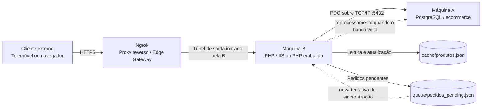
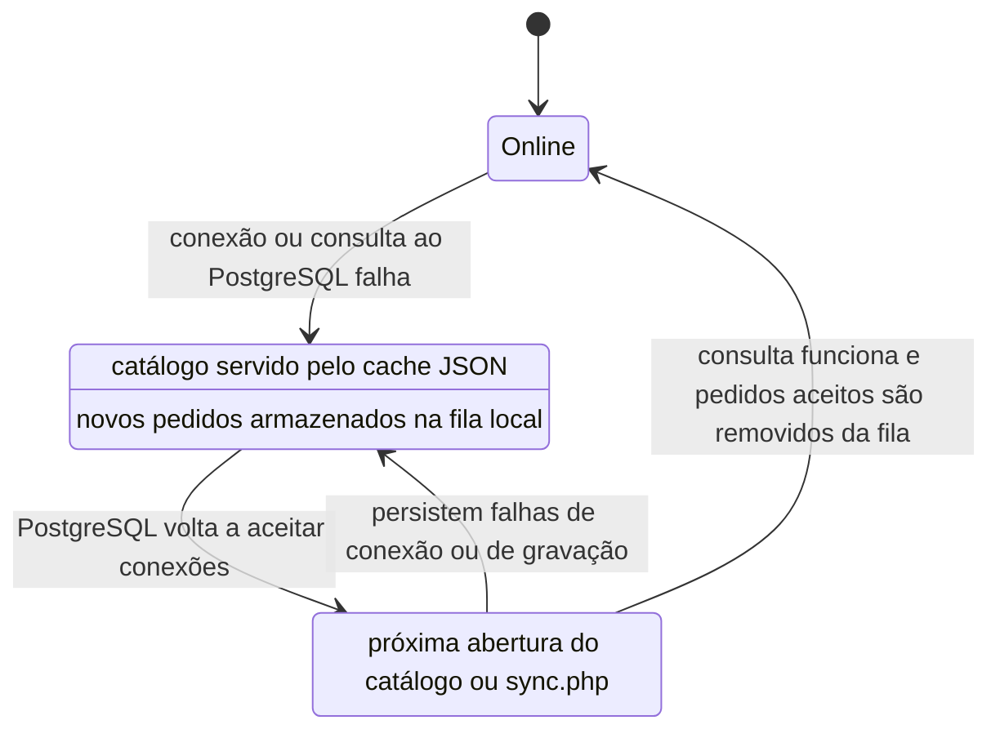

# Documentação Completa da TechStore Distribuída

**Projeto:** TechStore — comércio eletrônico distribuído
**Tecnologias:** PHP, PDO, PostgreSQL, JSON, HTTP e TCP/IP
**Finalidade:** demonstração acadêmica de distribuição entre cliente, aplicação e persistência, incluindo operação degradada e encaminhamento de pedidos pendentes.

## Sumário

1. [Introdução e fundamentação teórica](#1-introdução-e-fundamentação-teórica)
2. [Arquitetura de rede e infraestrutura](#2-arquitetura-de-rede-e-infraestrutura)
3. [Diagramas e fluxos de dados](#3-diagramas-e-fluxos-de-dados)
4. [Modelo de dados](#4-modelo-de-dados)
5. [Tolerância a falhas e modo degradado](#5-tolerância-a-falhas-e-modo-degradado)
6. [Instalação, execução e testes](#6-instalação-execução-e-testes)
7. [Limitações e recomendações](#7-limitações-e-recomendações)

## 1. Introdução e fundamentação teórica

### 1.1 Definição do projeto

A TechStore é uma aplicação web de comércio eletrônico cuja interface é entregue por um servidor PHP e cujos dados persistentes são mantidos em um servidor PostgreSQL. O sistema separa a apresentação e a lógica de aplicação da persistência, comunicando esses nós por protocolos de rede. Para preservar a disponibilidade percebida quando o banco não pode ser alcançado, a aplicação mantém uma cópia local do catálogo em JSON e aceita pedidos em uma fila local para sincronização posterior.

Em termos da definição clássica de sistema distribuído, os componentes de software executam em computadores distintos, coordenam-se por troca de mensagens em uma rede e apresentam ao utilizador uma aplicação coerente. O sistema não é apenas um programa com várias camadas lógicas: na topologia de apresentação, o processo PHP e o processo PostgreSQL podem estar em máquinas físicas diferentes, com falhas e tempos de comunicação próprios.

### 1.2 Por que é um sistema distribuído

A TechStore enquadra-se como sistema distribuído pelos seguintes aspectos:

- **Desacoplamento físico:** o servidor de aplicação e o servidor PostgreSQL são nós independentes, potencialmente hospedados em computadores diferentes.
- **Separação lógica:** o PHP recebe requisições HTTP, aplica regras do checkout e decide entre banco, cache e fila; o PostgreSQL executa operações relacionais e mantém a persistência central.
- **Independência de processamento:** cada máquina tem sistema operacional, recursos, processo e ciclo de vida próprios. Uma pode continuar executando enquanto a outra está indisponível.
- **Comunicação por rede:** o navegador usa HTTP/HTTPS para acessar a aplicação. O PHP usa uma conexão PostgreSQL sobre TCP/IP, normalmente na porta `5432`.
- **Falhas parciais:** a indisponibilidade do nó de persistência não implica necessariamente a interrupção completa da aplicação. O catálogo pode recorrer ao cache e o checkout pode aceitar um pedido pendente.
- **Ausência de memória compartilhada entre máquinas:** as informações atravessam os limites dos processos e dos computadores por requisições, respostas e operações de banco.

O banco permanece como fonte central dos dados persistentes durante a operação normal. O cache JSON e a fila não são replicação do PostgreSQL: são mecanismos locais de contingência que permitem atender algumas operações quando a comunicação com o banco falha.

### 1.3 Topologia física e papéis

| Nó | Papel | Responsabilidades |
| --- | --- | --- |
| **Máquina A — persistência** | PostgreSQL | Executa o serviço do PostgreSQL; mantém o banco `ecommerce`; armazena produtos, estoque, pedidos e itens de pedido; aceita conexões autorizadas da Máquina B. |
| **Máquina B — aplicação** | PHP com IIS ou servidor embutido | Recebe HTTP, executa os scripts PHP, consulta o banco por PDO, renderiza o catálogo e mantém `cache/produtos.json` e `queue/pedidos_pending.json`. |
| **Máquina C — cliente externo** | Navegador em computador ou telemóvel | Acessa o endereço público temporário disponibilizado pelo túnel e interage com a aplicação. Não recebe credenciais nem conecta diretamente ao PostgreSQL. |
| **Ngrok — edge gateway** | Túnel reverso gerenciado | Recebe a conexão HTTPS externa e encaminha o tráfego ao agente ngrok iniciado na Máquina B, que o entrega ao serviço HTTP local. |

Os papéis A, B e C descrevem a topologia pretendida para a demonstração. Em um teste local, A e B podem estar na mesma máquina; nesse caso, `DB_HOST=127.0.0.1` é coerente. Em duas máquinas, a Máquina B deve apontar para um endereço alcançável da Máquina A. O valor `127.0.0.1` sempre representa o próprio computador que executa o PHP, não o cliente nem uma máquina remota.

## 2. Arquitetura de rede e infraestrutura

### 2.1 Caminhos de comunicação

Existem dois caminhos distintos:

1. **Cliente para aplicação:** navegador → HTTPS do endereço ngrok → túnel ngrok → serviço HTTP local da Máquina B. O servidor embutido padrão deste projeto atende em `127.0.0.1:8080`; IIS pode utilizar outra porta conforme sua configuração.
2. **Aplicação para banco:** processo PHP na Máquina B → TCP/IP → PostgreSQL na Máquina A, normalmente na porta `5432`.

O ngrok resolve o acesso de entrada ao servidor web da Máquina B. Ele não altera automaticamente `DB_HOST`, não configura o firewall do PostgreSQL e não cria um túnel para a porta `5432`. A conectividade entre B e A deve existir separadamente, por uma rede local, hotspot que permita comunicação entre clientes, VPN privada ou outro enlace controlado.

### 2.2 Porta PostgreSQL, firewall e `pg_hba.conf`

O PostgreSQL costuma escutar na porta TCP `5432`. Para uma implantação distribuída:

- configure `listen_addresses` no `postgresql.conf` para escutar apenas nas interfaces de rede necessárias;
- crie uma regra de firewall que permita TCP `5432` somente a partir do endereço da Máquina B;
- configure `pg_hba.conf` para autorizar o banco e o usuário previstos, limitados ao IP/CIDR da Máquina B;
- use uma senha forte e não versione credenciais;
- valide o caminho a partir da Máquina B, por exemplo com `Test-NetConnection IP_DA_MAQUINA_A -Port 5432`.

Exemplo conceitual de uma regra restrita em `pg_hba.conf` (substituir os valores de exemplo):

```conf
# TYPE  DATABASE   USER       ADDRESS             METHOD
host    ecommerce  app_user   192.168.50.20/32    scram-sha-256
```

O valor `192.168.50.20/32` representa um único endereço IPv4 de origem. A regra deve ser compatível com o endereço que o PostgreSQL realmente observa na rede. Não use `0.0.0.0/0` nem encaminhe publicamente a porta `5432` para fins de apresentação.

Após modificar arquivos de configuração do PostgreSQL, valide-os e recarregue ou reinicie o serviço conforme a versão e o sistema operacional. A alteração da regra de firewall deve manter o mesmo princípio de menor privilégio.

### 2.3 Apresentação presencial com hotspot 4G/5G

Um hotspot móvel pode contornar o isolamento entre clientes (*AP Isolation*) encontrado em redes Wi-Fi acadêmicas ou corporativas. Para isso, conecte a Máquina A e a Máquina B ao mesmo hotspot e teste, a partir da Máquina B, se o endereço privado da Máquina A e a porta `5432` são alcançáveis.

Essa estratégia não é uma garantia: alguns hotspots também isolam clientes, aplicam regras de firewall ou não permitem comunicação entre dispositivos conectados. Faça a validação antecipadamente. Se a comunicação direta A→B não funcionar, use uma VPN privada entre as máquinas ou uma rede de laboratório autorizada. O ngrok, isoladamente, não substitui essa conectividade do PHP com o banco.

Para um telemóvel fora do hotspot ou em dados móveis, o túnel ngrok permite acessar o HTTP da Máquina B sem configurar encaminhamento de porta no roteador. A Máquina B inicia uma conexão de saída com o serviço ngrok; o serviço entrega as requisições externas por esse túnel. Essa propriedade é útil mesmo quando a rede móvel está atrás de NAT/CGNAT, desde que a conexão de saída para ngrok seja permitida.

### 2.4 `localhost` e túnel ngrok

`localhost` e `127.0.0.1` são endereços de loopback, válidos somente dentro do próprio host. Um navegador no telemóvel que acessa `http://127.0.0.1:8080` tenta alcançar o próprio telemóvel, não a Máquina B. Da mesma forma, `DB_HOST=127.0.0.1` no PHP tenta conectar ao PostgreSQL instalado na Máquina B.

O ngrok cria um endereço público de entrada, normalmente HTTPS, e estabelece um túnel reverso até um serviço local escolhido, como `http://127.0.0.1:8080`. O agente ngrok faz uma conexão de saída; não é necessário abrir a porta de entrada `8080` no roteador. O endereço pode ser temporário e mudar entre sessões conforme o plano e a configuração do serviço.

O endpoint público torna a aplicação acessível a terceiros que conheçam ou descubram o endereço. Use apenas dados de demonstração, não exponha interfaces administrativas, encerre o túnel ao terminar e considere proteção de acesso oferecida pela conta/configuração ngrok. Não inclua tokens de autenticação ngrok em documentação versionada, prints ou comandos compartilhados.

## 3. Diagramas e fluxos de dados

### 3.1 Topologia ponta a ponta



Representação alternativa em texto:

```text
[Cliente/Telemóvel (4G/5G)]
              |
              | HTTPS
              v
      [ngrok: Edge Gateway]
              |
              | túnel reverso até o serviço HTTP local
              v
 [Máquina B: PHP / IIS ou PHP :8080]
       |                         |
       | PDO / TCP :5432         +--> [cache/produtos.json]
       v                         +--> [queue/pedidos_pending.json]
 [Máquina A: PostgreSQL]
```

### 3.2 Requisição de catálogo

1. O navegador solicita `GET /` à URL HTTPS do túnel.
2. O ngrok encaminha a requisição pelo túnel até o servidor HTTP da Máquina B.
3. `index.php` chama `getDbConnection()` em `config.php`. A conexão PDO usa host, porta, banco e credenciais configurados no ambiente da Máquina B, com timeout definido no projeto.
4. Se a conexão estiver disponível, a aplicação tenta sincronizar pedidos pendentes e executa uma consulta de produtos com estoque. O resultado é salvo em `cache/produtos.json` e usado para renderizar a página.
5. Se a conexão ou a consulta falhar, a aplicação carrega o JSON local e identifica a apresentação como modo degradado.
6. O HTML e os recursos da interface retornam pelo servidor web, ngrok e navegador. Os filtros de categoria e busca são aplicados no cliente aos cards já renderizados.

### 3.3 Checkout

1. O navegador envia `POST /checkout.php` com os campos do cliente e os itens do carrinho.
2. O PHP valida a presença dos dados, calcula o total a partir dos dados recebidos e prepara as linhas do pedido.
3. Quando há conexão com o PostgreSQL, o processo abre uma transação, insere o pedido e seus itens e faz `COMMIT`. Em caso de erro, executa `ROLLBACK` quando a transação ainda está ativa.
4. Se a conexão não estiver disponível ou a gravação falhar, `enqueueOrder()` acrescenta o pedido a `queue/pedidos_pending.json`, com `local_id` e horário de inclusão.
5. A resposta informa `PAGO` para a gravação direta bem-sucedida ou `PENDENTE_SYNC` para o armazenamento local. Neste projeto, `PAGO` é o rótulo atual do fluxo de gravação; não existe integração com adquirente ou confirmação financeira externa.

## 4. Modelo de dados

### 4.1 Resumo das tabelas

| Nome da tabela | Descrição | Colunas principais | Papel na arquitetura |
| --- | --- | --- | --- |
| `produtos` | Cadastro descritivo e comercial do catálogo. | `id`, `nome`, `descricao`, `preco`, `imagem_url`, `categoria`, `criado_em` | Fonte central do catálogo; categoria alimenta os filtros da interface. |
| `estoque` | Quantidade disponível associada a produto. | `id`, `produto_id`, `quantidade`, `atualizado_em` | Complementa a leitura do catálogo com disponibilidade. |
| `pedidos` | Cabeçalho do pedido e dados do cliente. | `id`, `cliente_nome`, `cliente_email`, `valor_total`, `status`, `criado_em` | Registra a operação comercial persistida no PostgreSQL. |
| `itens_pedido` | Produtos e quantidades pertencentes a um pedido. | `id`, `pedido_id`, `produto_id`, `quantidade`, `preco_unitario` | Detalha o pedido e referencia cabeçalho e catálogo. |

### 4.2 Relacionamentos e integridade

- `estoque.produto_id` referencia `produtos.id`; a exclusão do produto remove o registro de estoque correspondente por `ON DELETE CASCADE`.
- `itens_pedido.pedido_id` referencia `pedidos.id`; a exclusão do pedido remove seus itens por `ON DELETE CASCADE`.
- `itens_pedido.produto_id` referencia `produtos.id`; não há `ON DELETE CASCADE` explícito nessa chave.
- `estoque.quantidade` possui `CHECK (quantidade >= 0)`.
- `itens_pedido.quantidade` possui `CHECK (quantidade > 0)`.
- Chaves primárias `SERIAL` identificam registros e geram sequências inteiras.
- `produtos.nome`, dados de cliente e preço têm restrições `NOT NULL` conforme o schema. O schema atual não declara `CHECK` para preço positivo, nem unicidade em `estoque.produto_id` ou `produtos.nome`.

O relacionamento lógico é:

```text
produtos 1 --- 0..N estoque
pedidos  1 --- 0..N itens_pedido
produtos 1 --- 0..N itens_pedido
```

Embora o domínio usual seja um registro de estoque por produto, o schema atual não impõe essa cardinalidade com uma restrição `UNIQUE`. O catálogo pressupõe um único registro de estoque por produto nos dados de demonstração.

### 4.3 Catálogo e script SQL idempotente

O `schema.sql` cria as tabelas com `CREATE TABLE IF NOT EXISTS`, adiciona a coluna `categoria` se ausente e envolve a execução em transação. O seed insere produtos somente quando não existe registro com o mesmo nome e insere estoque somente quando o produto ainda não possui linha correspondente. Os quatro produtos legados recebem categorias compatíveis.

O seed incluído distribui 12 itens entre três categorias:

| Categoria | Quantidade inicial |
| --- | ---: |
| Componentes | 4 |
| Notebooks | 4 |
| Periféricos | 4 |
| **Total** | **12** |

Essa idempotência é adequada para reexecuções sequenciais do script de demonstração. Ela não equivale a uma garantia de unicidade concorrente: não existe constraint `UNIQUE(nome)` e duas execuções simultâneas poderiam disputar a verificação `NOT EXISTS`. Além disso, os registros adicionais já existentes no banco não são removidos; portanto, em uma base previamente populada com outros produtos, o total poderá ser superior a 12. O seed não deve ser tratado como migração completa de produção.

## 5. Tolerância a falhas e modo degradado

### 5.1 Cache local do catálogo

`cache/produtos.json` armazena um objeto com `timestamp` e uma lista em `data`. Durante a operação online, os dados consultados no PostgreSQL, incluindo categoria e estoque, atualizam o arquivo. Se a conexão ou consulta do catálogo falhar, o backend lê o último conteúdo válido disponível e renderiza os produtos a partir dele.

O fallback mantém a consulta do catálogo disponível, mas os dados representam o último snapshot gravado. Alterações feitas no PostgreSQL depois do snapshot não serão visíveis até uma atualização bem-sucedida do cache. A camada de leitura atribui uma categoria de compatibilidade a registros antigos que não possuam esse campo; essa inferência não substitui a atualização do banco.

### 5.2 Fila local de pedidos

Quando a gravação do pedido no PostgreSQL falha, a aplicação acrescenta um objeto ao arquivo `queue/pedidos_pending.json`. O registro contém dados do cliente, total, itens, `queued_at` e um `local_id`. Isso caracteriza o padrão **store-and-forward**: persistir temporariamente a intenção no nó de aplicação e encaminhá-la ao destino quando a comunicação for restabelecida.

Com o banco online, `processQueue()` tenta inserir cada pedido e seus itens em uma transação individual. Se a transação for concluída, o pedido é removido da fila. Se ocorrer uma exceção, há rollback quando aplicável e o pedido permanece para uma tentativa futura. A sincronização pode ocorrer quando o catálogo é aberto com banco disponível ou por acesso a `sync.php`.

### 5.3 Ciclo de operação e recuperação



O termo **self-healing** deve ser entendido aqui como recuperação oportunística, não como um processo autônomo permanentemente ativo. Não há daemon, health check agendado ou worker em segundo plano: uma nova requisição ao catálogo ou a execução manual de `sync.php` dispara a tentativa. Se nenhuma requisição ocorrer, a fila não será processada até a próxima execução.

### 5.4 Limites de consistência e durabilidade

O mecanismo demonstra continuidade parcial, mas não garante entrega exatamente uma vez. O `local_id` identifica localmente um pedido, porém não é persistido no banco como chave de idempotência; se a conexão cair após o commit e antes da confirmação percebida pelo PHP, uma nova tentativa pode duplicar o pedido. Os arquivos JSON também são escritos sem bloqueio explícito, escrita atômica ou coordenação entre múltiplos processos. O checkout recebe preço e quantidade do navegador e não revalida o preço nem reserva/decrementa estoque no servidor.

Essas limitações são relevantes para explicar que o mecanismo é didático. Não utilizar a fila JSON como garantia de durabilidade para comércio eletrônico real sem adicionar validação de servidor, idempotência persistida, controle transacional de estoque, escrita concorrente segura, monitoramento e tratamento de credenciais.

## 6. Instalação, execução e testes

### 6.1 Pré-requisitos

- Windows 10 ou superior para os comandos apresentados.
- PHP 8.2 ou superior; neste repositório há uma distribuição PHP em `tools/php/`.
- Extensões PHP `pdo_pgsql` (e suporte PostgreSQL correspondente) habilitadas no `php.ini` ativo.
- PostgreSQL acessível pela Máquina B, com banco `ecommerce`.
- Node.js opcional para `node --check`.
- Conta e agente ngrok configurados para o teste externo.
- Rede validada entre as máquinas A e B; conectividade HTTPS de saída da Máquina B para o ngrok.

### 6.2 Preparar PostgreSQL na Máquina A

1. Instale e inicie o PostgreSQL na Máquina A.
2. Crie o banco de demonstração, se ainda não existir. No `psql`, conectado a um banco administrativo:

   ```sql
   CREATE DATABASE ecommerce;
   ```

3. Copie `schema.sql` para a Máquina A e execute-o no banco correto:

   ```powershell
   psql -U postgres -d ecommerce -f .\schema.sql
   ```

4. Verifique a distribuição inicial:

   ```sql
   SELECT categoria, COUNT(*)
   FROM produtos
   GROUP BY categoria
   ORDER BY categoria;
   ```

   Em um banco vazio, o esperado é quatro produtos por categoria, totalizando 12.

5. Em uma implantação remota, configure `listen_addresses`, a regra restrita no firewall e `pg_hba.conf` conforme a seção [2.2](#22-porta-postgresql-firewall-e-pg_hbaconf). Crie um usuário de aplicação de privilégio limitado para um ambiente real; não é recomendável usar o superusuário `postgres` pela aplicação.

### 6.3 Configurar a Máquina B

1. Na Máquina B, configure `DB_HOST`, `DB_PORT`, `DB_NAME`, `DB_USER` e `DB_PASS` em `config.php` ou no mecanismo externo adotado. Use `127.0.0.1` apenas se o PostgreSQL estiver na própria Máquina B. Para a topologia A/B, `DB_HOST` deve ser o IP ou nome de rede da Máquina A.
2. Não publique nem compartilhe a senha. Caso uma credencial real já tenha sido incluída em arquivo versionado, remova-a do código, faça rotação e configure uma variável ou arquivo externo protegido.
3. Confirme a rede e a porta a partir da Máquina B:

   ```powershell
   Test-NetConnection IP_DA_MAQUINA_A -Port 5432
   ```

   O teste esperado é `TcpTestSucceeded : True`. Um `ping` bem-sucedido, isoladamente, não valida PostgreSQL; um `ping` bloqueado também não prova que a porta TCP está bloqueada.

4. Confirme o driver com o PHP do projeto:

   ```powershell
   .\tools\php\php.exe -m | Select-String 'PDO|pgsql'
   ```

### 6.4 Iniciar o servidor PHP

Na raiz do projeto, na Máquina B:

```powershell
.\tools\php\php.exe -S 127.0.0.1:8080 -t .
```

Deixe esse terminal aberto. No próprio computador, acesse `http://127.0.0.1:8080/`. O estado esperado é **Banco online** com 12 produtos quando o PostgreSQL e a configuração estiverem corretos. Em ambiente IIS, use a URL e a porta configuradas no site e aponte o túnel para essa porta.

### 6.5 Publicar a aplicação de demonstração com ngrok

Em outro terminal na Máquina B:

1. Instale o ngrok seguindo a documentação oficial do serviço.
2. Autentique o agente usando o procedimento oficial. O token é segredo: não o inclua neste documento, no Git ou em gravações públicas.
3. Com o servidor PHP já ativo na porta `8080`, inicie o túnel HTTP:

   ```powershell
   ngrok http 8080
   ```

4. Copie o endereço HTTPS indicado pelo agente e abra-o no telemóvel usando dados móveis ou em outro computador fora da rede local.
5. Mantenha ambos os processos (PHP e ngrok) ativos durante o teste. Ao concluir, encerre o agente ngrok e o servidor PHP.

Esse comando publica o serviço web HTTP. **Não** use `ngrok tcp 5432` para expor o banco nesta apresentação. O PostgreSQL deve permanecer acessível apenas pela rede privada autorizada entre as máquinas A e B. O endereço público do túnel pode mudar entre execuções e a aplicação exposta deve conter apenas dados de demonstração.

### 6.6 Roteiro de apresentação ao vivo

#### Etapa A — operação normal

1. Confirme que PostgreSQL está ativo na Máquina A e que a Máquina B alcança `5432`.
2. Inicie a aplicação e o túnel ngrok.
3. Abra a URL pública em um telemóvel usando a rede móvel.
4. Mostre o banner **Banco online**, os 12 produtos e a distribuição de quatro itens por categoria.
5. Selecione Componentes, Notebooks e Periféricos; verifique quatro resultados por seleção e 12 em Todos os produtos.
6. Adicione um item ao carrinho e demonstre o feedback do botão e a atualização do carrinho.

#### Etapa B — falha controlada

1. Garanta que o cache tenha sido criado durante uma consulta online.
2. Em uma base isolada para demonstração, interrompa temporariamente o PostgreSQL ou bloqueie apenas a comunicação da Máquina B com a Máquina A.
3. Recarregue a página pelo mesmo endereço ngrok. O esperado é a indicação de modo degradado e o catálogo lido do JSON.
4. Faça um pedido com dados fictícios. O esperado é `PENDENTE_SYNC` e uma nova entrada em `queue/pedidos_pending.json`.
5. Não faça essa simulação em banco compartilhado, ambiente de produção ou com dados pessoais reais. Evite alterar regras amplas de firewall; prefira parar o serviço de teste ou bloquear somente o fluxo de demonstração.

#### Etapa C — recuperação

1. Restaure o serviço e o caminho TCP entre B e A.
2. Abra novamente o catálogo ou acesse `sync.php` pelo endereço da aplicação.
3. Confirme o retorno do estado online e a tentativa de processamento da fila.
4. Verifique no PostgreSQL as linhas de teste em `pedidos` e `itens_pedido`, e confirme que pedidos processados foram removidos da fila.
5. Registre que a sincronização depende de nova requisição ou chamada manual, não de um worker automático.

### 6.7 Verificações auxiliares

Sintaxe PHP e JavaScript na Máquina B:

```powershell
Get-ChildItem -Filter *.php | ForEach-Object { .\tools\php\php.exe -l $_.FullName }
node --check .\assets\js\app.js
```

Verificação visual e funcional recomendada:

- resposta HTTP bem-sucedida na página inicial;
- estado de conexão condizente com a disponibilidade do banco;
- total e contagens das categorias;
- combinação de busca e categoria;
- carregamento pelo cache durante indisponibilidade do banco;
- registro local e sincronização posterior de pedido de teste;
- ausência de exposição direta do PostgreSQL ao cliente externo.

## 7. Limitações e recomendações

1. **Credenciais:** manter usuário e senha fora do repositório, usar uma conta PostgreSQL de privilégio mínimo e rotacionar segredos expostos.
2. **Validação de checkout:** recalcular preço no servidor, validar IDs e quantidades e verificar estoque dentro da transação.
3. **Idempotência:** persistir uma chave única do pedido local no banco e rejeitar reprocessamentos duplicados.
4. **Fila durável:** substituir JSON por mecanismo transacional ou broker quando houver concorrência, volume ou requisito forte de durabilidade.
5. **Concorrência:** adotar locks ou escritas atômicas para cache e fila, além de estratégia para múltiplos workers.
6. **Self-healing:** adicionar health checks e worker agendado se a recuperação precisar ocorrer sem uma requisição de usuário.
7. **Rede:** restringir `5432` ao IP da Máquina B; disponibilizar apenas HTTPS público da aplicação e proteger o endpoint de demonstração.
8. **Observabilidade:** adicionar logs estruturados, métricas de conexão/fila, alertas e rastreamento de falhas.
9. **Consistência do seed:** adicionar constraints de unicidade e migrations versionadas antes de permitir implantação concorrente ou atualização do catálogo em produção.

O escopo atual é apropriado para demonstrar separação entre nós, comunicação em rede, contingência local e sincronização transacional básica. As recomendações acima são evoluções necessárias para uso comercial ou para afirmar garantias de alta disponibilidade e durabilidade.

## Referências técnicas

- PHP: documentação oficial de PDO — <https://www.php.net/manual/en/book.pdo.php>
- PostgreSQL: documentação oficial — <https://www.postgresql.org/docs/>
- ngrok: documentação oficial — <https://ngrok.com/docs/>
- Coulouris, George et al. *Sistemas Distribuídos: Conceitos e Projeto*. 5. ed. Bookman, 2013.
- Tanenbaum, Andrew S.; Van Steen, Maarten. *Sistemas Distribuídos: Princípios e Paradigmas*. 2. ed. Pearson Prentice Hall, 2007.